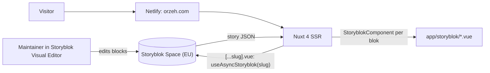

# Architecture

1. `app/pages/[...slug].vue` resolves any path to a story slug (`/` → `home`)
   and loads it with `useAsyncStoryblok` (`version: 'draft'`, `bridge: {}`).
2. `Page.vue` renders the story's `body`; each block is resolved to a component
   in `app/storyblok/` (auto-import, or the explicit registrations in
   `app/plugins/storyblok-components.ts` for snake_case names).
3. In the Visual Editor the Storyblok bridge re-renders blocks live; every block
   root carries `v-editable`.
4. Styling is Tailwind CSS 4 with tokens in `app/assets/css/main.css`; icons
   from `lucide-vue-next`.

Local development runs on `https://localhost:3000` (`vite-plugin-mkcert`),
because the Visual Editor only embeds HTTPS pages.
